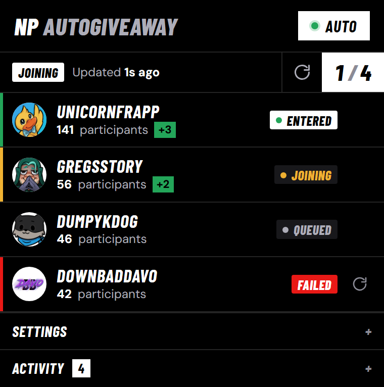
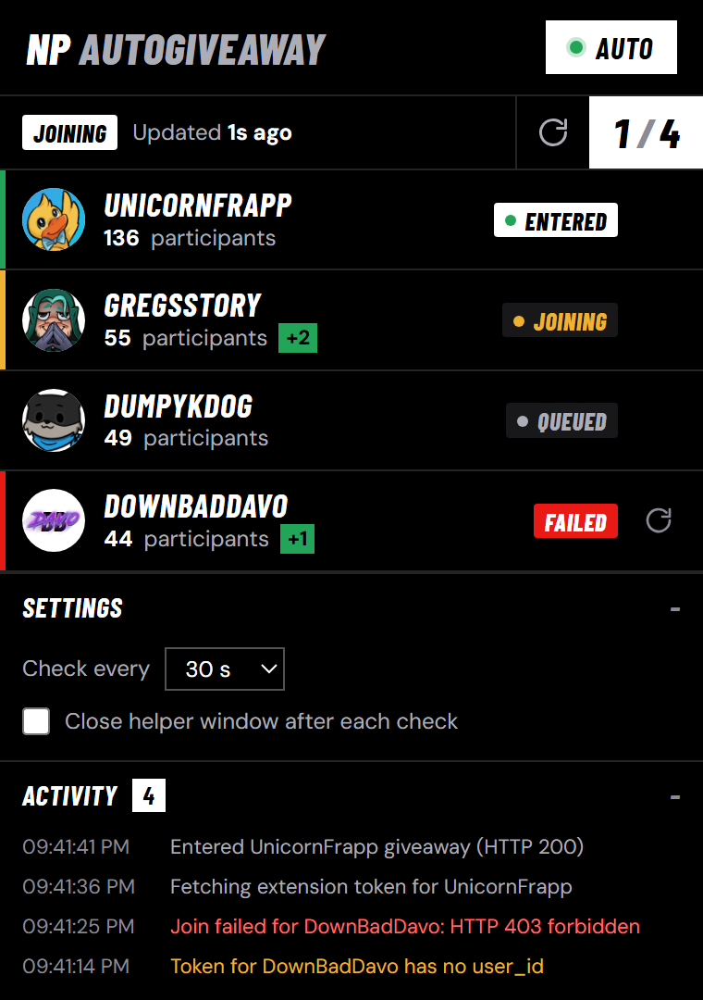

# NP AutoGiveaway

Firefox add-on that automatically enters live **NoPixel Twitch card giveaways**, so you never miss a pack.

> Unofficial fan project. Not affiliated with NoPixel, Twitch or nopixellink.dev.

  
  &nbsp;&nbsp;
  

## Install

1. Open the [**latest release**](https://github.com/VoidSector/NP-AutoGiveaway/releases/latest) and click **`np-autogiveaway-<version>.xpi`** in Firefox (140 or newer).
2. Accept the permissions and the data notice.
3. Log in to **Twitch**, open any NoPixel stream once and allow the NoPixel extension to **see your Twitch identity**.
4. Click the **NP AutoGiveaway** toolbar icon and make sure **AUTO** is on.

Updates install automatically.

## Features

- **Auto-enter** every live card giveaway, once per round, with a single on/off switch
- **Live participant counts** while the popup is open
- **Per-giveaway status:** Queued, Joining, Entered, Failed (with retry) or Ended
- **Activity log** showing what was entered and why anything failed
- **Quiet:** one minimized, muted helper window instead of new tabs

## Privacy

- Your Twitch extension token is sent **only** to the NoPixel extension's own server, to join giveaways.
- Tokens are kept in memory only and cleared when Firefox closes.
- No analytics, no tracking, nothing sent to the author.
- The giveaway list and streamer avatars come from nopixellink.dev.

## Heads up

Automated entry may go against NoPixel's or Twitch's rules. **Use at your own risk.** Your account is the one on the line.
